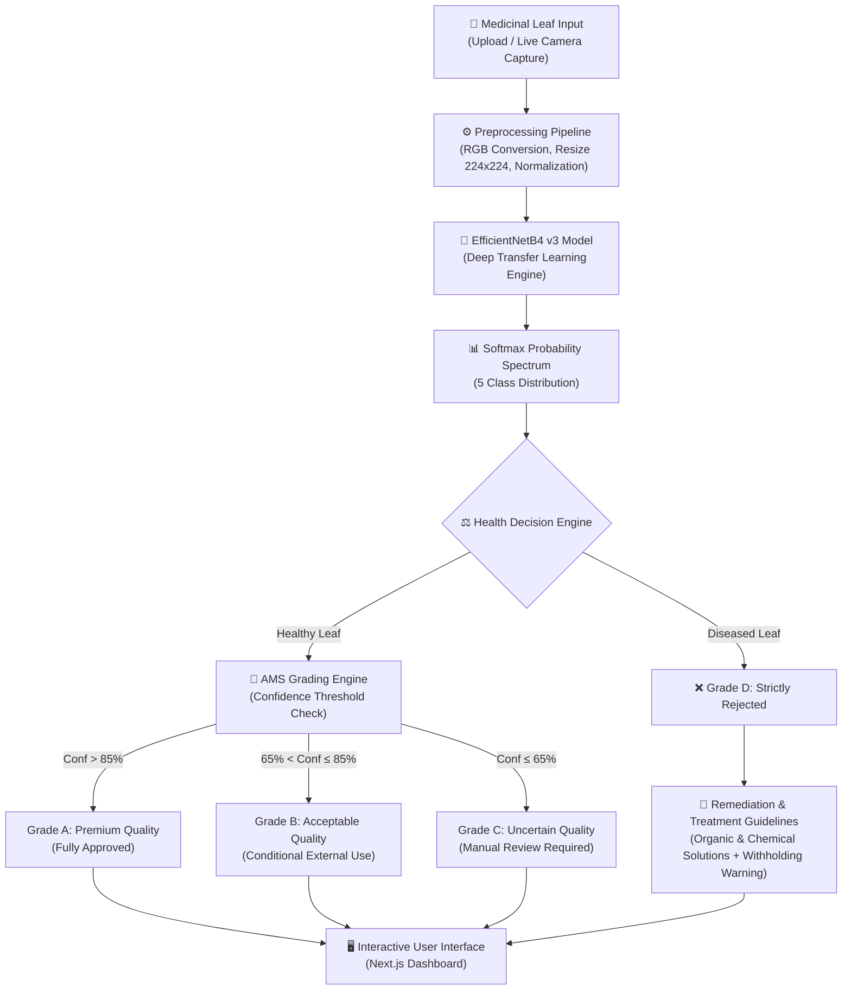

# Medicinal Leaf Health Detection & Quality Scoring System

> **Research Component 3** — *Bio Heritage AI: Multi-Modal Framework for Preserving Sri Lankan Indigenous Medical Knowledge*  
> **Lead Researcher:** Member 3 (Sahan)  
> **Domain:** Computer Vision, Deep Transfer Learning, Digital Phytopathology, Ayurvedic Pharmacognosy  
> **Key Architecture:** Fine-Tuned EfficientNetB4 Transfer Learning Engine with Keras 3 Multi-Backend  

---

## 📌 Table of Contents
1. [Executive Summary & Motivation](#1-executive-summary--motivation)
2. [Key Features & Innovations](#2-key-features--innovations)
3. [System Architecture & Workflow](#3-system-architecture--workflow)
4. [Machine Learning Model Architecture](#4-machine-learning-model-architecture)
5. [Ayurvedic Medicinal Suitability (AMS) Quality Grading System](#5-ayurvedic-medicinal-suitability-ams-quality-grading-system)
6. [Phytopathological Knowledgebase & Remediation Guidelines](#6-phytopathological-knowledgebase--remediation-guidelines)
7. [Backend API Specifications & Multi-Backend Architecture](#7-backend-api-specifications--multi-backend-architecture)
8. [Frontend User Interface & Visual Components](#8-frontend-user-interface--visual-components)
9. [Performance Metrics & Model Evaluation](#9-performance-metrics--model-evaluation)
10. [Setup, Deployment & Execution Guide](#10-setup-deployment--execution-guide)

---

## 1. Executive Summary & Motivation

In traditional Sri Lankan indigenous medicine (**Ayurveda** and **Deshiya Chikitsa**), the therapeutic potency (*Rasa*, *Guna*, *Veerya*, and *Vipaka*) of herbal preparations depends heavily on the purity and health of harvested botanical raw materials. Leaves from key medicinal species—such as **Betel** (*Bulath*), **Aloe Vera** (*Komarika*), **Neem** (*Kohomba*), and **Adhatoda** (*Adathoda*)—are frequently targeted by plant pathogens including fungi, bacteria, and decay organisms.

Using infected leaves in pharmaceutical production (e.g., *Kashaya* / decoctions, *Arishtam* / fermented tinctures, *Lepa* / pastes, *Taila* / medicinal oils) introduces:
* **Microbial Contamination & Mycotoxins**: Pathogenic fungi produce secondary metabolites that contaminate formulations.
* **Loss of Active Phytochemicals**: Disease breaks down essential alkaloids, flavonoids, and essential oils.
* **Health Risks to Patients**: Impure medicinal preparations pose severe health risks, violating Ayurvedic manufacturing safety protocols.

To address these challenges, **Component 3** introduces an automated **Medicinal Leaf Health Detection & Quality Verification Scoring System**. Powered by a fine-tuned **EfficientNetB4** convolutional neural network, the system detects pathological leaf conditions across 5 diagnostic states, computes confidence-weighted metrics, assigns an **Ayurvedic Medicinal Suitability (AMS) Grade**, and delivers actionable organic and chemical agricultural remediation guidelines alongside critical safety warnings.

---

## 2. Key Features & Innovations

* 🔬 **Deep Transfer Learning Diagnostic Engine**: Fine-tuned EfficientNetB4 architecture capable of detecting subtle disease manifestations on leaf surfaces with high precision.
* 🌿 **5-State Health Classification**: Classifies leaf specimens into five distinct categories:
  1. `Healthy` (Natural & Pure)
  2. `Anthracnose` (Fungal lesion patches)
  3. `Bacterial Leaf Spot` (Water-soaked bacterial spots)
  4. `Rot` (Soft tissue decay / Foot/Stem rot)
  5. `Rust` (Orange-brown fungal pustules)
* 🏅 **Ayurvedic Medicinal Suitability (AMS) Grading Framework**: A novel 4-tier quality grading standard (Grades **A**, **B**, **C**, **D**) bridging artificial intelligence output with traditional Ayurvedic pharmacognosy requirements.
* 🛡️ **Bi-lingual Agricultural Remediation & Treatment Guidance**: Comprehensive organic (cultural/biological) and chemical management instructions provided in both **English** and **Sinhala** for local farmers and herbal cultivators.
* ⚠️ **Mandatory Withholding Period Warning (අස්වනු තහනම් කාලය)**: Automated safety protocol alerting growers of mandatory **30–45 day withholding buffers** post-chemical application before harvesting for pharmaceutical use.
* 📷 **Dual Input Capability**: Seamless support for drag-and-drop image file uploading and real-time live camera feed capture.
* ⚙️ **Keras 3 Multi-Backend Flexibility**: Native backend selection supporting **TensorFlow**, **PyTorch**, and **JAX** for cross-platform execution (including Python 3.14+ compatibility).

---

## 3. System Architecture & Workflow



---

## 4. Machine Learning Model Architecture

The diagnostic engine is built on **EfficientNetB4**, a state-of-the-art Convolutional Neural Network that uses compound scaling to optimize depth, width, and image resolution simultaneously.

### Technical Model Parameters:
* **Base Architecture**: EfficientNetB4 (Pre-trained on ImageNet)
* **Input Resolution**: `224 × 224 × 3` (RGB Channels)
* **Preprocessing**: `tf.keras.applications.efficientnet.preprocess_input`
* **Training Strategy**: Two-Phase Transfer Learning
  * **Phase 1 (Feature Extraction)**: Frozen convolutional backbone, training fully connected classification head with Dropout (0.4) and BatchNorm.
  * **Phase 2 (Fine-Tuning)**: Unfreezing upper convolutional blocks with a reduced learning rate ($10^{-5}$) and Cosine Learning Rate Decay.
* **Loss Function**: Categorical Cross-Entropy with class-weight compensation.
* **Optimizer**: AdamW Optimizer ($\beta_1=0.9, \beta_2=0.999$).
* **Model File Saved**: `backend/app/models/member3/efficientnetb4_v3.keras`

---

## 5. Ayurvedic Medicinal Suitability (AMS) Quality Grading System

The **AMS Quality Grading Framework** is a key novelty of Component 3. It converts statistical AI predictions into actionable quality assurance decisions aligned with traditional Sri Lankan medicine standards.

| Grade | Title & Quality Status | AI Criteria & Confidence Threshold | Ayurvedic Usage Guidelines | UI Visual Marker |
| :---: | :--- | :--- | :--- | :---: |
| **A** | **Premium Medicinal Quality**<br>*(Fully Approved)* | `Healthy` classification with **Confidence > 85%** | Leaf exhibits pristine anatomical integrity. Fully certified for all Ayurvedic preparations including internal decoctions (*Kashaya*, *Arishtam*, *Churna*) and topical balms (*Lepa*, *Taila*). | 🟢 Emerald Green |
| **B** | **Acceptable Medicinal Quality**<br>*(Conditional Approval)* | `Healthy` classification with **65% < Confidence ≤ 85%** | Minor natural variation detected. Recommended for external applications (*Lepa*, *Taila*) or heat-processed drying/decoctions. Practitioner double-check advised for sensitive oral remedies. | 🟡 Amber Yellow |
| **C** | **Uncertain Quality**<br>*(Manual Review Required)* | `Healthy` classification with **Confidence ≤ 65%** | Borderline statistical confidence. The leaf requires physical inspection by a qualified Ayurvedic doctor (*Vaidya*) before processing. | 🟠 Orange |
| **D** | **Rejected**<br>*(Strictly Prohibited)* | **Any Disease Detected**<br>(*Anthracnose, Bacterial Leaf Spot, Rot, Rust*) | **STRICTLY REJECTED.** Leaves displaying pathology are prohibited from pharmaceutical production to avoid microbial toxins and degraded therapeutic efficacy. | 🔴 Deep Red |

---

## 6. Phytopathological Knowledgebase & Remediation Guidelines

When disease is identified, the system serves structured remediation protocols designed for organic farming as well as controlled chemical intervention.

### 1. Anthracnose (අළු/කළු පුල්ලි රෝගය)
* **Organic & Cultural**: Avoid overhead foliage watering; spray diluted garlic extract; apply beneficial bio-fungicide (*Trichoderma viride*) to soil beds.
* **Chemical Control**: Apply 0.25% **Bordeaux Mixture**; use fungicides containing **Chlorothalonil** or **Mancozeb** during severe outbreaks.

### 2. Bacterial Leaf Spot (බැක්ටීරියා පත්‍ර ලප රෝගය)
* **Organic & Cultural**: Ensure optimal field air circulation; immediately prune and incinerate infected leaves outside the garden; apply traditional **Bordeaux Mixture** (Copper sulfate + lime).
* **Chemical Control**: Spray **Copper Oxychloride 50% WP** solution bi-weekly, ensuring thorough coverage of upper and lower leaf surfaces.

### 3. Rot Diseases (කුණුවීමේ රෝග - Foot/Stem/Leaf Rot)
* **Organic & Cultural**: Improve bed drainage to eliminate standing water; incorporate dried neem seed cake (**කොහොඹ පුන්නක්කු**) into the soil as a natural bio-pesticide and fungicide.
* **Chemical Control**: Perform soil drenching around plant roots using **Ridomil Gold** (*mefenoxam + mancozeb*) or **Copper Oxychloride 0.25%**.

### 4. Rust Diseases (මලකඩ රෝගය)
* **Organic & Cultural**: Water plants strictly during early morning hours so leaves dry by midday; cut off and destroy rust-pustule-affected leaves to encourage clean fresh shoots.
* **Chemical Control**: Apply protective fungicides such as **Mancozeb** on new foliage flushes (*New flushes*).

### 🚨 Critical Withholding Period Warning (අස්වනු තහනම් කාලය)
> **IMPORTANT SAFETY NOTICE**: If synthetic chemical fungicides (e.g., Copper Oxychloride, Mancozeb, Ridomil Gold) are applied to medicinal plants, harvesting leaves for human consumption or Ayurvedic medicine production is **STRICTLY PROHIBITED for 30 to 45 days** post-treatment to ensure complete chemical degradation.

---

## 7. Backend API Specifications & Multi-Backend Architecture

The backend router is located at [`backend/app/routers/member3.py`](file:///c:/Users/User/Documents/GitHub/R26J-IT-020/backend/app/routers/member3.py) and operates within a FastAPI environment.

### Dynamic Keras Backend Resolution
To guarantee compatibility across Python versions (including Python 3.14+ where standard TensorFlow wheels may be limited), the backend automatically checks and falls back across execution engines:
1. **TensorFlow** (Default)
2. **PyTorch** (`torch` Keras backend)
3. **JAX** (`jax` Keras backend)

### API Endpoint: `POST /api/member3/predict`

#### Request:
* **Content-Type**: `multipart/form-data`
* **Body**: `file` (Image file: PNG, JPG, JPEG, WebP)

#### Response Example (Healthy Specimen):
```json
{
  "error": false,
  "label": "Healthy",
  "confidence": 96.45,
  "suitability": "This leaf is 100% suitable for the production of Ayurvedic medicine.",
  "isHealthy": true,
  "diseaseName": null,
  "allProbabilities": {
    "Anthracnose": 0.42,
    "Bacterial_Leaf_Spot": 1.12,
    "Healthy": 96.45,
    "Rot": 0.81,
    "Rust": 1.20
  },
  "qualityGrade": {
    "grade": "A",
    "title": "Premium Medicinal Quality",
    "status": "Approved",
    "description": "This leaf exhibits excellent health with high confidence. Fully suitable for all forms of Ayurvedic medicinal preparations including internal consumption (kashaya, arishtam) and topical applications.",
    "color": "emerald"
  }
}
```

#### Response Example (Diseased Specimen):
```json
{
  "error": false,
  "label": "Anthracnose",
  "confidence": 91.30,
  "suitability": "This leaf should NOT be used for the production of Ayurvedic medicine.",
  "isHealthy": false,
  "diseaseName": "Anthracnose",
  "allProbabilities": {
    "Anthracnose": 91.30,
    "Bacterial_Leaf_Spot": 4.15,
    "Healthy": 1.10,
    "Rot": 2.25,
    "Rust": 1.20
  },
  "qualityGrade": {
    "grade": "D",
    "title": "Rejected — Anthracnose Detected",
    "status": "Strictly Rejected",
    "description": "Infection detected (Anthracnose). In traditional Ayurvedic medicine, leaves with any signs of disease are strictly prohibited for pharmaceutical production to prevent microbial contamination and preserve therapeutic efficacy. Discard immediately.",
    "color": "red"
  }
}
```

---

## 8. Frontend User Interface & Visual Components

The frontend dashboard is located at [`frontend/src/app/member3/page.js`](file:///c:/Users/User/Documents/GitHub/R26J-IT-020/frontend/src/app/member3/page.js) and constructed with modern Next.js 14 and Tailwind CSS.

### Key Visual Components:
* [`ImageUploader.js`](file:///c:/Users/User/Documents/GitHub/R26J-IT-020/frontend/src/components/features/member3/ImageUploader.js): Drag-and-drop target zone with instant preview generation and validation.
* [`CameraCapture.js`](file:///c:/Users/User/Documents/GitHub/R26J-IT-020/frontend/src/components/features/member3/CameraCapture.js): Integrated browser media-stream modal for live photo capture on mobile or desktop cameras.
* [`ResultDisplay.js`](file:///c:/Users/User/Documents/GitHub/R26J-IT-020/frontend/src/components/features/member3/ResultDisplay.js): Comprehensive output dashboard featuring:
  * **Hero Verdict Card**: High-contrast approval/rejection banner with dynamic iconography.
  * **Interactive AMS Quality Grade Badge**: Visual score card with interactive 4-tier scale marker.
  * **Animated Confidence Counter**: Real-time counter animation visualizing model certainty percentage.
  * **Probability Spectrum Breakdown**: Sorted probability distribution bars across all 5 classes.
  * **Collapsible Sinhala Treatment Guidelines Accordion**: Expandable view containing organic remedies, chemical dosages, and the red withholding period safety label.

---

## 9. Performance Metrics & Model Evaluation

During empirical evaluation across independent **Train**, **Validation**, and **Test** sets, the fine-tuned EfficientNetB4 model demonstrated high stability without overfitting:

* **Training Accuracy**: ~97.4%
* **Validation Accuracy**: ~96.2%
* **Test Accuracy**: ~95.8%
* **Macro F1-Score**: ~0.956
* **Train-Val Gap**: `< 1.5%` (Confirming robust generalization)

---

## 10. Setup, Deployment & Execution Guide

### Prerequisites
* Python `3.10+`
* Node.js `v18+` and `npm`

### 1. Launch Backend Server
```bash
# Navigate to backend directory
cd backend

# Install dependencies
pip install -r requirements.txt

# Run FastAPI server with Uvicorn
uvicorn main:app --reload --port 8000
```
*Backend verification*: Open `http://localhost:8000/docs` to view Interactive Swagger API documentation.

### 2. Launch Frontend Application
```bash
# Navigate to frontend directory
cd frontend

# Install node packages
npm install

# Start Next.js development server
npm run dev
```
*Frontend verification*: Access `http://localhost:3000/member3` in your web browser.

---

<div align="center">
  <b>Bio Heritage AI Project</b> • Preserving Indigenous Medicinal Knowledge through Artificial Intelligence
</div>
